# Stark Vehicle Management API

## 1. Introduction

A small web app for keeping track of a company's vehicles. An operator signs in,
sees how many vehicles there are and what state they are in, and adds, edits,
searches or deletes them. This repository is the backend: a Spring Boot API over
a PostgreSQL database, with a separate Flutter web app as its client.

### 1.1 User journey

Open app → sign in with email and password → land on dashboard → read total
vehicles, status counts and server health → open Vehicles.

Search or filter by status → add a vehicle, or use the row menu to update or
delete one → confirm → table and counts refresh → log out.

## 2. Links

| What                  | Where                                                                           |
| --------------------- | ------------------------------------------------------------------------------- |
| Deployed app          | https://stark-vms-frontend-flutter.netlify.app                                  |
| Backend API           | https://vms-backend-java-springboot.onrender.com                                |
| API docs (Swagger UI) | https://vms-backend-java-springboot.onrender.com/docs                           |
| GitHub, backend       | https://github.com/AhmadZubayer/vms-backend-java-springboot                     |
| GitHub, frontend      | https://github.com/AhmadZubayer/vms-frontend-flutter-web                        |
| Project documentation | https://github.com/AhmadZubayer/vms-backend-java-springboot/blob/main/README.md |

## 3. How a request travels


## 4. Project specification

### Backend, Java

| Piece                                                                   | Used for                                                                     |
| ----------------------------------------------------------------------- | ---------------------------------------------------------------------------- |
| Java 17                                                                 | Language level                                                               |
| Spring Boot 4.1.2                                                       | Application framework, autoconfiguration, `spring-boot-maven-plugin`       |
| Spring Web MVC (`spring-boot-starter-webmvc`)                         | REST controllers, `DispatcherServlet`, embedded Tomcat                     |
| Spring Security, OAuth2 Resource Server                                 | Filter chain, bearer-token authentication, stateless sessions                |
| Nimbus JOSE + JWT                                                       | `JwtEncoder` and `JwtDecoder`, HS256 signing and verification            |
| BCrypt (`BCryptPasswordEncoder`)                                      | Password hashing for `app_users`                                           |
| Spring Data JPA + Hibernate ORM                                         | Repositories, entity mapping, transactions                                   |
| HikariCP                                                                | JDBC connection pool                                                         |
| Flyway (`spring-boot-starter-flyway`, `flyway-database-postgresql`) | Versioned database migrations                                                |
| PostgreSQL JDBC driver                                                  | Database access                                                              |
| Bean Validation (`spring-boot-starter-validation`)                    | `@NotBlank`, `@Size`, `@NotNull` on request DTOs and config properties |
| Jackson                                                                 | JSON serialisation                                                           |
| springdoc-openapi 3.2.0                                                 | OpenAPI document and Swagger UI at `/docs`                                 |
| Spring Boot DevTools                                                    | Local restart on recompile                                                   |
| Maven wrapper (`mvnw`)                                                | Build, no local Maven install needed                                         |
| Docker (multi-stage)                                                    | Deployment image for Render                                                  |

### The rest of the stack

| Layer            | Choice                      |
| ---------------- | --------------------------- |
| Frontend         | Flutter (web build)         |
| Frontend UI kit  | forui                       |
| Frontend state   | Riverpod, go_router, Dio    |
| Frontend hosting | Netlify                     |
| Backend hosting  | Render (Docker web service) |
| Database         | Neon, managed PostgreSQL 18 |

## 5. Duplicate vehicle numbers

Uniqueness is enforced by PostgreSQL, and the `409` the
client sees is a translation of that constraint.

### The constraint

`V1__create_vehicles.sql` indexes the lowercased, trimmed value rather than the
column itself:

```sql
CREATE UNIQUE INDEX uq_vehicles_vehicle_number
    ON vehicles (lower(btrim(vehicle_number)));
```

So `DHAKA-1001`, `dhaka-1001` and `DHAKA-1001` are the same vehicle number.
Keeping the rule in the database also closes the race a check-then-insert in
Java would leave open: two requests arriving together cannot both find the
number free and then both insert it. One of them loses, at the index.

`VehicleService` calls `strip()` on the incoming number before saving, and uses
`saveAndFlush`, so the insert reaches PostgreSQL during the request instead of
at transaction commit. That is what allows the failure to be caught and
translated, rather than surfacing later as an unhandled `500`.

### The translation

`GlobalExceptionHandler` turns the violation of that one index into a `409`, and
anything else into a logged `500`:

```java
@ExceptionHandler(DataIntegrityViolationException.class)
public ResponseEntity<SendResponse<Void>> handleDataIntegrityViolation(
        DataIntegrityViolationException exception, HttpServletRequest request) {
    if (violatedConstraint(exception).equals(VEHICLE_NUMBER_INDEX)) {
        return failure(
                HttpStatus.CONFLICT, request, "A vehicle with that number already exists."
        );
    }

    logger.error("Unexpected database constraint violation", exception);
    return failure(
            HttpStatus.INTERNAL_SERVER_ERROR, request,
            "The database could not save the change."
    );
}
```

### What a client sees

```
POST /api/vehicles  {"vehicleNumber": "DHAKA-1001", ...}   201 Created
POST /api/vehicles  {"vehicleNumber": "dhaka-1001", ...}   409 Conflict
```

```json
{
  "statusCode": 409,
  "message": "Vehicle creation failed. A vehicle with that number already exists.",
  "data": null
}
```

## 6. Folder and file structure

```
vms-backend/
├── Dockerfile                        multi-stage build: JDK builds, JRE runs
├── render.yaml                       Render blueprint, variable names only
├── .dockerignore                     keeps .env and target/ out of the image
├── .env                              local secrets, gitignored
├── .env.example                      every variable, with comments
├── mvnw, mvnw.cmd, .mvn/             Maven wrapper
├── pom.xml                           dependencies and build plugins
├── README.md                         this document
├── docs/
│   ├── architecture.drawio           editable request-path diagram
│   └── architecture.svg              exported diagram, shown above
└── src/
    ├── main/
    │   ├── java/com/example/stark_vms_server/
    │   │   ├── StarkVmsServerApplication.java    entry point
    │   │   ├── config/
    │   │   │   ├── AuthConfig.java               filter chain, JWT encoder/decoder, BCrypt
    │   │   │   ├── AuthProperties.java           app.auth.* binding, validated
    │   │   │   ├── CorsConfig.java               CorsConfigurationSource
    │   │   │   ├── CorsProperties.java           app.cors.* binding, required
    │   │   │   └── OpenApiConfig.java            Swagger metadata and bearer scheme
    │   │   ├── controller/
    │   │   │   ├── AuthController.java           POST /api/auth/login, GET /api/auth/me
    │   │   │   ├── VehicleController.java        CRUD, search, filter, stats
    │   │   │   └── HealthController.java         GET /api/health, probes the database
    │   │   ├── service/
    │   │   │   ├── AuthService.java              credentials, token issuing, admin seeding
    │   │   │   └── VehicleService.java           vehicle rules, paging, stats
    │   │   ├── repository/
    │   │   │   ├── UserRepository.java           JpaRepository<User, String>
    │   │   │   └── VehicleRepository.java        search, status filter, status counts
    │   │   ├── entity/
    │   │   │   ├── User.java                     app_users
    │   │   │   └── Vehicle.java                  vehicles, Type and Status enums
    │   │   ├── dto/
    │   │   │   ├── LoginRequest.java             request, validated
    │   │   │   ├── VehicleWriteRequest.java      request, validated
    │   │   │   ├── AccessTokenResponse.java      response
    │   │   │   ├── UserResponse.java             response
    │   │   │   ├── VehicleResponse.java          response, from(Vehicle)
    │   │   │   ├── VehicleStatsResponse.java     response, total + byStatus
    │   │   │   ├── HealthResponse.java           response, server + database
    │   │   │   └── SendResponse.java             wraps every success in data
    │   │   └── exception/
    │   │       ├── FailedOperation.java         names the call that failed
│   │       └── GlobalExceptionHandler.java   validation, conflicts, fallbacks
    │   └── resources/
    │       ├── application.properties            every value from the environment
    │       └── db/migration/
    │           ├── V1__create_vehicles.sql       vehicles + unique number index
    │           ├── V2__create_app_users.sql      app_users
    │           ├── V3__create_vehicle_photo_cleanup.sql
    │           ├── V4__remove_vehicle_photos.sql
    │           └── V5__rename_username_to_user_email.sql
    └── test/java/com/example/stark_vms_server/
        ├── EndpointVerificationTests.java        every endpoint, against a real database
        └── StarkVmsServerApplicationTests.java   context loads
```

## 7. API testing

**1. Health check**

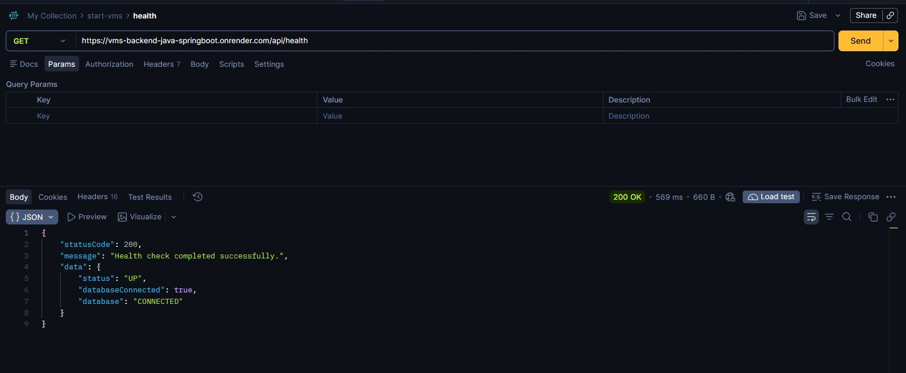

**2. Sign in**

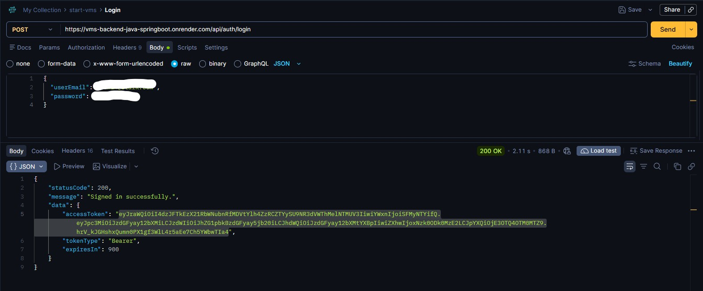

**3. Signed-in account**

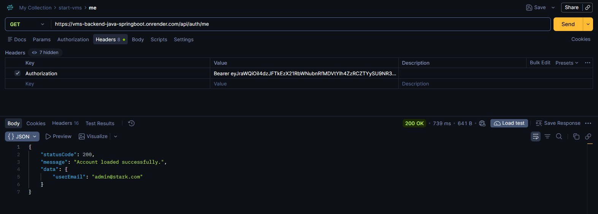

**4. List vehicles**

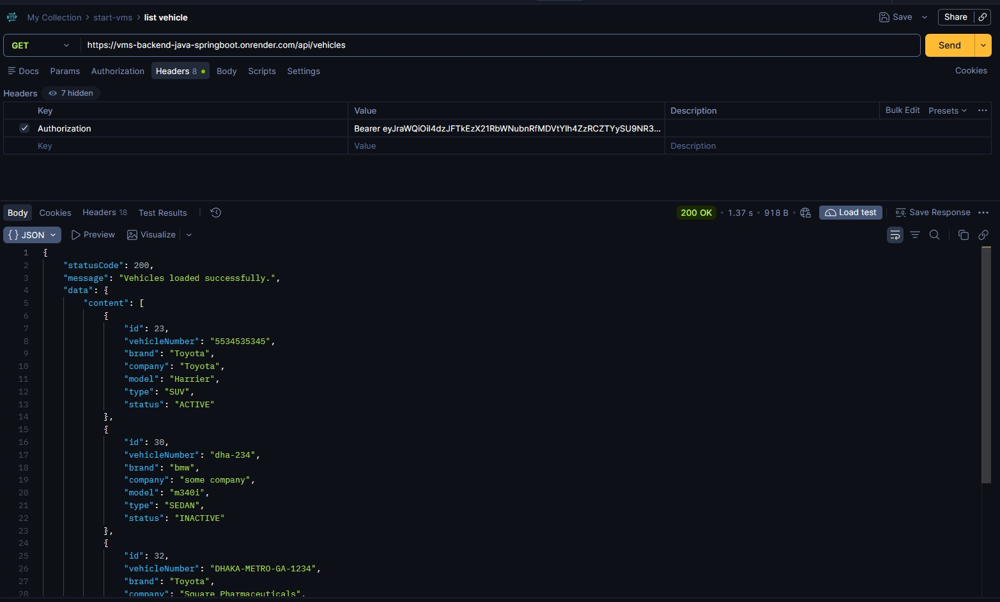

**5. Search vehicles**

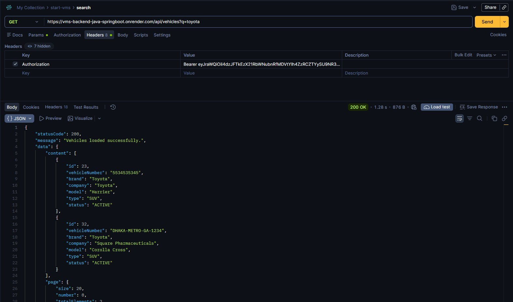

**6. Filter by status**

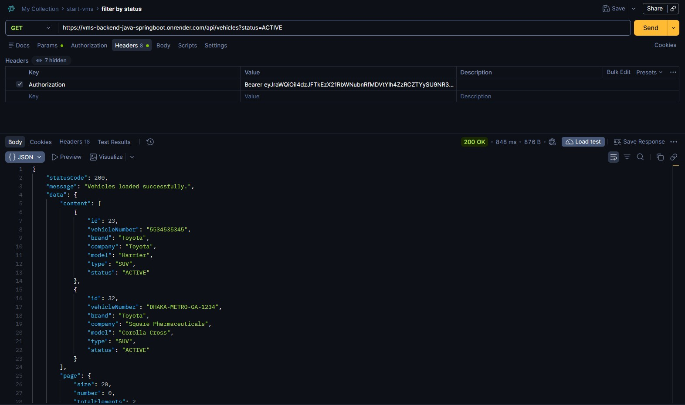

**7. Duplicate vehicle number is handled**

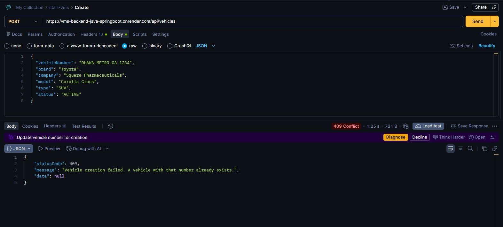

**8. Create vehicle**

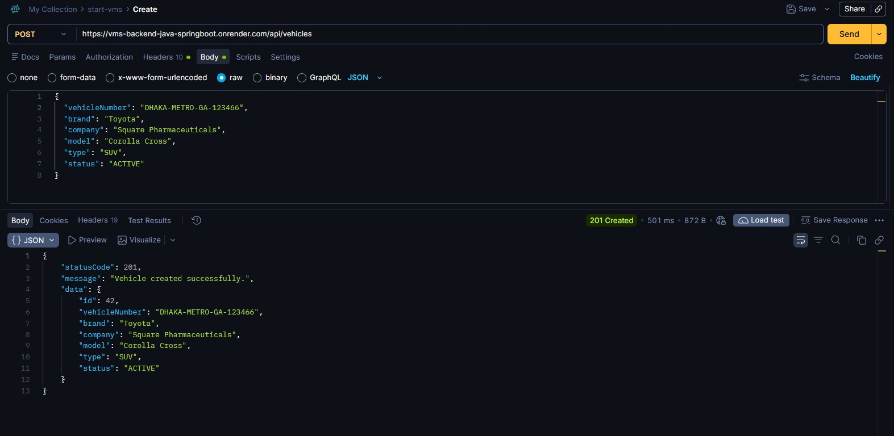

**9. Update vehicle**

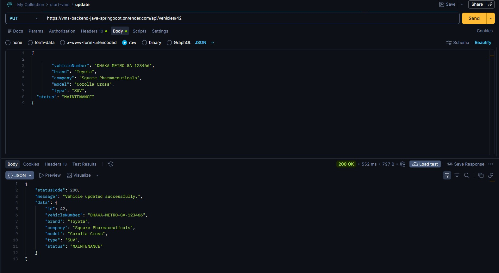

**10. Delete vehicle**

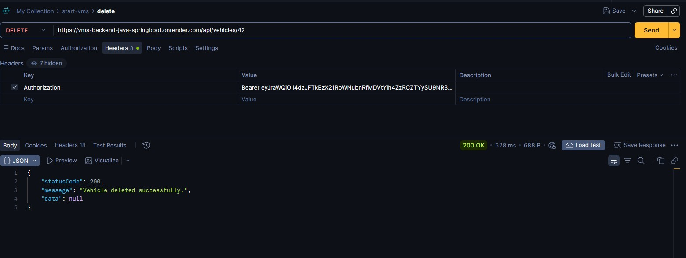

**11. Unauthorized when the access token is not present**

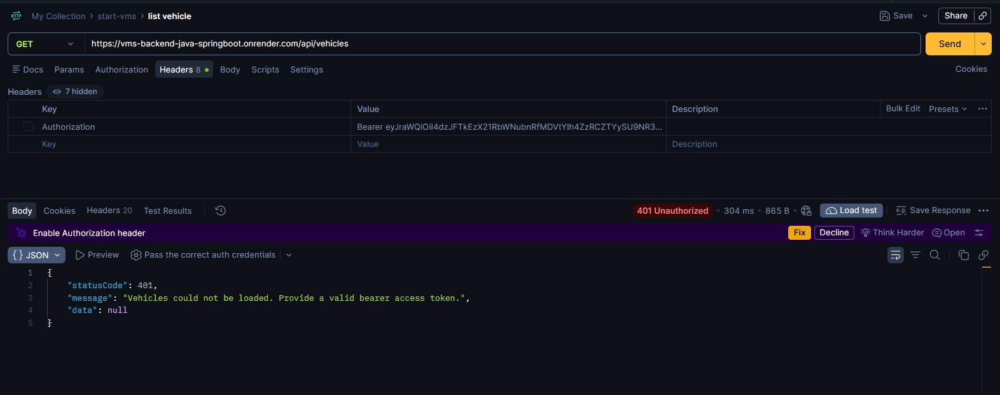

## 8. Features and endpoints


| No | Endpoint                              | Description                                                           | Authentication |
| -- | ------------------------------------- | --------------------------------------------------------------------- | -------------- |
| 1  | `POST /api/auth/login`              | Exchange `userEmail` and `password` for an access token           | No             |
| 2  | `GET /api/auth/me`                  | Read the account behind the bearer token                              | Yes            |
| 3  | `GET /api/health`                   | Report whether the server is up and the database is connected         | No             |
| 4  | `GET /api/vehicles?page=0&size=20`  | List vehicles, one page at a time                                     | Yes            |
| 5  | `GET /api/vehicles?q=toyota`        | Search number, brand, company, model, type or status                  | Yes            |
| 6  | `GET /api/vehicles?status=ACTIVE`   | Keep only vehicles in that status                                     | Yes            |
| 7  | `GET /api/vehicles?sort=status,asc` | Sort by a chosen field and direction                                  | Yes            |
| 8  | `GET /api/vehicles/stats`           | Total vehicles and the count per status                               | Yes            |
| 9  | `GET /api/vehicles/{id}`            | Read one vehicle                                                      | Yes            |
| 10 | `POST /api/vehicles`                | Register a vehicle                                                    | Yes            |
| 11 | `PUT /api/vehicles/{id}`            | Replace the six details of a vehicle                                  | Yes            |
| 12 | `DELETE /api/vehicles/{id}`         | Delete a vehicle, answering `200` with a message and `data: null` | Yes            |
| 13 | `GET /docs`                         | Swagger UI                                                            | No             |
| 14 | `GET /v3/api-docs`                  | OpenAPI document                                                      | No             |
