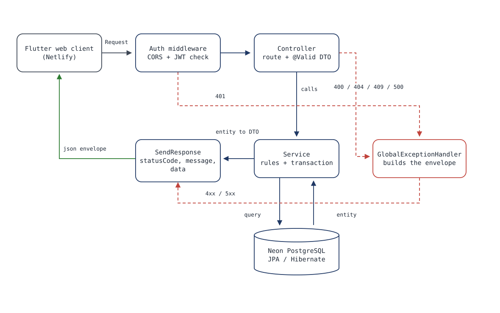

# Stark Vehicle Management API

## 1. What this is

A small web app for keeping track of a company's vehicles. An operator signs in,
sees how many vehicles there are and what state they are in, and adds, edits,
searches or deletes them. This repository is the backend: a Spring Boot API over
a PostgreSQL database, with a separate Flutter web app as its client.

### 1.1 User journey

Open app → sign in with email and password → land on dashboard → read total
vehicles, status counts and server health → open Vehicles.

Search or filter by status → add a vehicle, or use the row menu to update or
delete one → confirm → table and counts refresh → log out.

## 2. Links

| What | Where |
| --- | --- |
| Deployed app | https://stark-vms-frontend-flutter.netlify.app |
| Backend API | https://vms-backend-java-springboot.onrender.com |
| API docs (Swagger UI) | https://vms-backend-java-springboot.onrender.com/docs |
| GitHub, backend | https://github.com/AhmadZubayer/vms-backend-java-springboot |
| GitHub, frontend | https://github.com/AhmadZubayer/vms-frontend-flutter-web |
| Project documentation | https://github.com/AhmadZubayer/vms-backend-java-springboot/blob/main/README.md |

## 3. How a request travels



| Step | What happens |
| --- | --- |
| **Flutter web client** | The Netlify-hosted app sends the request with its stored token as `Authorization: Bearer <token>`, and is where both answers land. |
| **Auth middleware** | The Spring Security filter chain: `CorsFilter` checks the browser origin, then the bearer token is decoded and its signature, issuer, audience and expiry verified. `/api/health`, `/api/auth/login` and `/docs` are let through without a token; anything else without a valid one stops here with `401`. |
| **Controller** | `DispatcherServlet` routes to `AuthController`, `VehicleController` or `HealthController`. The JSON body is bound to a request DTO (`LoginRequest`, `VehicleWriteRequest`) and `@Valid` checks it before any logic runs. |
| **Service** | `AuthService` and `VehicleService` hold the rules and the transaction. The DTO becomes an entity here on the way down (the vehicle number is stripped, enums are stored by name), and the entity coming back from the database becomes a response DTO here too (`VehicleResponse.from`). Nothing skips the service in either direction. |
| **Neon PostgreSQL** | Spring Data JPA repositories and Hibernate turn that entity into SQL over a HikariCP connection and hand the rows back to the service as entities; Flyway has already migrated the schema at startup. |
| **SendResponse** | The controller wraps whatever the service returned in the envelope — `statusCode`, `message`, `data` — and Jackson writes it as JSON, `200` or `201`. |
| **GlobalExceptionHandler** | Every failure is caught here — validation `400`, auth `401`, missing row `404`, duplicate number `409`, anything unexpected `500` — and handed to `SendResponse` as well, so a failure answers in the same envelope as a success. |

The source is [`docs/architecture.drawio`](docs/architecture.drawio), editable at
[diagrams.net](https://app.diagrams.net). A fuller version showing every filter,
class and table is in
[`docs/architecture-detailed.drawio`](docs/architecture-detailed.drawio)
([SVG](docs/architecture-detailed.svg)).

DTOs and entities stay apart on purpose: DTOs are the shape of the wire and
carry the validation annotations, entities are the shape of the database and
carry the JPA mapping. Only the service layer sees both.

## 4. Project specification

### Backend, Java

| Piece | Used for |
| --- | --- |
| Java 17 | Language level |
| Spring Boot 4.1.2 | Application framework, autoconfiguration, `spring-boot-maven-plugin` |
| Spring Web MVC (`spring-boot-starter-webmvc`) | REST controllers, `DispatcherServlet`, embedded Tomcat |
| Spring Security, OAuth2 Resource Server | Filter chain, bearer-token authentication, stateless sessions |
| Nimbus JOSE + JWT | `JwtEncoder` and `JwtDecoder`, HS256 signing and verification |
| BCrypt (`BCryptPasswordEncoder`) | Password hashing for `app_users` |
| Spring Data JPA + Hibernate ORM | Repositories, entity mapping, transactions |
| HikariCP | JDBC connection pool |
| Flyway (`spring-boot-starter-flyway`, `flyway-database-postgresql`) | Versioned database migrations |
| PostgreSQL JDBC driver | Database access |
| Bean Validation (`spring-boot-starter-validation`) | `@NotBlank`, `@Size`, `@NotNull` on request DTOs and config properties |
| Jackson | JSON serialisation |
| springdoc-openapi 3.2.0 | OpenAPI document and Swagger UI at `/docs` |
| Spring Boot DevTools | Local restart on recompile |
| Maven wrapper (`mvnw`) | Build, no local Maven install needed |
| Docker (multi-stage) | Deployment image for Render |

Java types in this project, by role: configuration (`AuthConfig`,
`AuthProperties`, `CorsConfig`, `CorsProperties`, `OpenApiConfig`), controllers
(`AuthController`, `VehicleController`, `HealthController`), services
(`AuthService`, `VehicleService`), repositories (`UserRepository`,
`VehicleRepository`), entities (`User`, `Vehicle`), DTO records
(`LoginRequest`, `VehicleWriteRequest`, `AccessTokenResponse`, `UserResponse`,
`VehicleResponse`, `VehicleStatsResponse`, `HealthResponse`, `SendResponse`),
and one `@RestControllerAdvice` (`GlobalExceptionHandler`).

### The rest of the stack

| Layer | Choice |
| --- | --- |
| Frontend | Flutter (web build) |
| Frontend UI kit | forui |
| Frontend state | Riverpod, go_router, Dio |
| Frontend hosting | Netlify |
| Backend hosting | Render (Docker web service) |
| Database | Neon, managed PostgreSQL 18 |

## 5. Duplicate vehicle numbers

Uniqueness is enforced by PostgreSQL, not by application code, and the `409` the
client sees is a translation of that constraint.

### The constraint

`V1__create_vehicles.sql` indexes the lowercased, trimmed value rather than the
column itself:

```sql
CREATE UNIQUE INDEX uq_vehicles_vehicle_number
    ON vehicles (lower(btrim(vehicle_number)));
```

So `DHAKA-1001`, `dhaka-1001` and `  DHAKA-1001  ` are the same vehicle number.
Keeping the rule in the database also closes the race a check-then-insert in
Java would leave open: two requests arriving together cannot both find the
number free and then both insert it. One of them loses, at the index.

`VehicleService` calls `strip()` on the incoming number before saving, and uses
`saveAndFlush`, so the insert reaches PostgreSQL during the request instead of
at transaction commit. That is what allows the failure to be caught and
translated, rather than surfacing later as an unhandled `500`.

### The translation

`GlobalExceptionHandler` turns the violation of that one index into a `409`, and
anything else into a logged `500`:

```java
@ExceptionHandler(DataIntegrityViolationException.class)
public ProblemDetail handleDataIntegrityViolation(DataIntegrityViolationException exception) {
    if (violatedConstraint(exception).equals(VEHICLE_NUMBER_INDEX)) {
        return ProblemDetail.forStatusAndDetail(
                HttpStatus.CONFLICT, "A vehicle with that number already exists."
        );
    }

    logger.error("Unexpected database constraint violation", exception);
    return ProblemDetail.forStatusAndDetail(
            HttpStatus.INTERNAL_SERVER_ERROR, "The database could not save the change."
    );
}
```

`violatedConstraint` reads the constraint name from the Hibernate
`ConstraintViolationException` cause, so only this index produces the duplicate
message; an unrelated integrity failure is never mislabelled as a duplicate.

### What a client sees

```
POST /api/vehicles  {"vehicleNumber": "DHAKA-1001", ...}   201 Created
POST /api/vehicles  {"vehicleNumber": "dhaka-1001", ...}   409 Conflict
```

```json
{
  "statusCode": 409,
  "message": "Vehicle creation failed. A vehicle with that number already exists.",
  "data": null
}
```

`data` is `null` because the clash is with a stored row rather than with the
shape of the request; a validation failure would list the offending fields
there instead. `PUT /api/vehicles/{id}` answers the same way, so renaming a
vehicle to a number another one already holds is also a `409`.

## 6. Folder and file structure

```
vms-backend/
├── Dockerfile                        multi-stage build: JDK builds, JRE runs
├── render.yaml                       Render blueprint, variable names only
├── .dockerignore                     keeps .env and target/ out of the image
├── .env                              local secrets, gitignored
├── .env.example                      every variable, with comments
├── mvnw, mvnw.cmd, .mvn/             Maven wrapper
├── pom.xml                           dependencies and build plugins
├── README.md                         this document
├── docs/
│   ├── architecture.drawio           editable request-path diagram
│   └── architecture.svg              exported diagram, shown above
└── src/
    ├── main/
    │   ├── java/com/example/stark_vms_server/
    │   │   ├── StarkVmsServerApplication.java    entry point
    │   │   ├── config/
    │   │   │   ├── AuthConfig.java               filter chain, JWT encoder/decoder, BCrypt
    │   │   │   ├── AuthProperties.java           app.auth.* binding, validated
    │   │   │   ├── CorsConfig.java               CorsConfigurationSource
    │   │   │   ├── CorsProperties.java           app.cors.* binding, required
    │   │   │   └── OpenApiConfig.java            Swagger metadata and bearer scheme
    │   │   ├── controller/
    │   │   │   ├── AuthController.java           POST /api/auth/login, GET /api/auth/me
    │   │   │   ├── VehicleController.java        CRUD, search, filter, stats
    │   │   │   └── HealthController.java         GET /api/health, probes the database
    │   │   ├── service/
    │   │   │   ├── AuthService.java              credentials, token issuing, admin seeding
    │   │   │   └── VehicleService.java           vehicle rules, paging, stats
    │   │   ├── repository/
    │   │   │   ├── UserRepository.java           JpaRepository<User, String>
    │   │   │   └── VehicleRepository.java        search, status filter, status counts
    │   │   ├── entity/
    │   │   │   ├── User.java                     app_users
    │   │   │   └── Vehicle.java                  vehicles, Type and Status enums
    │   │   ├── dto/
    │   │   │   ├── LoginRequest.java             request, validated
    │   │   │   ├── VehicleWriteRequest.java      request, validated
    │   │   │   ├── AccessTokenResponse.java      response
    │   │   │   ├── UserResponse.java             response
    │   │   │   ├── VehicleResponse.java          response, from(Vehicle)
    │   │   │   ├── VehicleStatsResponse.java     response, total + byStatus
    │   │   │   ├── HealthResponse.java           response, server + database
    │   │   │   └── SendResponse.java             wraps every success in data
    │   │   └── exception/
    │   │       ├── FailedOperation.java         names the call that failed
│   │       └── GlobalExceptionHandler.java   validation, conflicts, fallbacks
    │   └── resources/
    │       ├── application.properties            every value from the environment
    │       └── db/migration/
    │           ├── V1__create_vehicles.sql       vehicles + unique number index
    │           ├── V2__create_app_users.sql      app_users
    │           ├── V3__create_vehicle_photo_cleanup.sql
    │           ├── V4__remove_vehicle_photos.sql
    │           └── V5__rename_username_to_user_email.sql
    └── test/java/com/example/stark_vms_server/
        ├── EndpointVerificationTests.java        every endpoint, against a real database
        └── StarkVmsServerApplicationTests.java   context loads
```

## 7. Features and endpoints

Sign in with an email and password, read how many vehicles exist and how they
split across statuses, register a vehicle, search and filter the registry page
by page, update or delete a row, and check whether the server and its database
are reachable. Every write is validated, duplicates are refused, and every
failure comes back in one shape.

| No | Endpoint | Description | Authentication |
| --- | --- | --- | --- |
| 1 | `POST /api/auth/login` | Exchange `userEmail` and `password` for an access token | No |
| 2 | `GET /api/auth/me` | Read the account behind the bearer token | Yes |
| 3 | `GET /api/health` | Report whether the server is up and the database is connected | No |
| 4 | `GET /api/vehicles?page=0&size=20` | List vehicles, one page at a time | Yes |
| 5 | `GET /api/vehicles?q=toyota` | Search number, brand, company, model, type or status | Yes |
| 6 | `GET /api/vehicles?status=ACTIVE` | Keep only vehicles in that status | Yes |
| 7 | `GET /api/vehicles?sort=status,asc` | Sort by a chosen field and direction | Yes |
| 8 | `GET /api/vehicles/stats` | Total vehicles and the count per status | Yes |
| 9 | `GET /api/vehicles/{id}` | Read one vehicle | Yes |
| 10 | `POST /api/vehicles` | Register a vehicle | Yes |
| 11 | `PUT /api/vehicles/{id}` | Replace the six details of a vehicle | Yes |
| 12 | `DELETE /api/vehicles/{id}` | Delete a vehicle, answering `200` with a message and `data: null` | Yes |
| 13 | `GET /docs` | Swagger UI | No |
| 14 | `GET /v3/api-docs` | OpenAPI document | No |

There is no logout route. Access tokens are self-contained and short lived, so
signing out is the client discarding its token; the server keeps no session to
end. A token that leaks stays usable until it expires, which is why
`APP_TOKEN_LIFETIME_SECONDS` defaults to 15 minutes. If you ever need an
immediate server-side revocation, store each token's `jti` in Redis or a table
on logout and reject those ids in the `JwtDecoder` validator.

## 8. Running it locally

Java 17 and `mvnw.cmd spring-boot:run` from `vms-backend`. Copy `.env.example`
to `.env` first; every environment-specific value, the database URL and the
allowed browser origins included, is read from there. Spring loads the local
`.env` file, and Flyway applies pending migrations to PostgreSQL when the app
starts.

| Setting | Value |
| --- | --- |
| `DB_URL`, `DB_USERNAME`, `DB_PASSWORD` | PostgreSQL JDBC URL and credentials |
| `APP_JWT_SECRET` | Base64-encoded signing key of at least 32 random bytes |
| `APP_ADMIN_EMAIL`, `APP_ADMIN_PASSWORD` | First-run operator credentials. When the user email is new, the app saves a bcrypt hash in PostgreSQL. |
| `APP_CORS_ALLOWED_ORIGIN_PATTERNS` | Comma-separated browser origins allowed to call `/api/**`. Required: no origin is compiled in, and start-up fails if it is empty. `*` is allowed as a wildcard, so `http://localhost:*` covers the port a Flutter web dev server picks and `https://vms.example.com` names a deployed client. |
| `SERVER_PORT` | Port the API listens on. Optional, defaults to `8080`; a host that injects `PORT`, such as Render, wins over it. |
| `APP_TOKEN_LIFETIME_SECONDS` | Access token lifetime in seconds. Optional, defaults to `900` (15 minutes). |
| `APP_MAX_PASSWORD_BYTES` | Longest accepted password in UTF-8 bytes. Optional, defaults to `72`; bcrypt ignores input beyond 72 bytes, so higher values are rejected at start-up. |

## 9. API

### Sign in

Send a JSON request to `POST /api/auth/login` with `userEmail` and `password`.
Copy `data.accessToken` and select **Bearer Token** under Authorization for
vehicle requests. Tokens expire after 15 minutes by default.

Swagger UI is at `/docs`, which redirects to `/swagger-ui/index.html`, and the
OpenAPI document at `/v3/api-docs`. Both are open without a token; use
**Authorize** to paste an access token and try the vehicle routes.

### Response shape

Every successful response is formatted by `SendResponse`: the HTTP status
repeated as `statusCode`, a plain `message` saying what happened, and the
payload under `data`.

```json
{
  "statusCode": 201,
  "message": "Vehicle created successfully.",
  "data": {
    "id": 7,
    "vehicleNumber": "DHAKA-METRO-GA-1234",
    "brand": "Toyota",
    "company": "Square Pharmaceuticals",
    "model": "Corolla Cross",
    "type": "SUV",
    "status": "ACTIVE"
  }
}
```

The messages are `Signed in successfully.`, `Account loaded successfully.`,
`Health check completed successfully.`, `Vehicles loaded successfully.`,
`Vehicle loaded successfully.`, `Vehicle statistics loaded successfully.`,
`Vehicle created successfully.`, `Vehicle updated successfully.` and
`Vehicle deleted successfully.`

Deleting answers `200` with `"data": null` rather than `204`, so the message has
somewhere to live. `GET /api/health` puts `status`, `databaseConnected` and
`database` in `data`, so a client can tell a running server from a reachable
database.

Failures answer in the **same envelope**, so there is one shape to read:

```json
{
  "statusCode": 409,
  "message": "Vehicle creation failed. A vehicle with that number already exists.",
  "data": null
}
```

`data` is `null` on a failure, except for a validation failure, where it carries
the offending fields:

```json
{
  "statusCode": 400,
  "message": "Vehicle creation failed. Some fields are invalid.",
  "data": [
    { "field": "vehicleNumber", "message": "must not be blank" },
    { "field": "brand", "message": "must not be blank" }
  ]
}
```

Each message names the operation that failed and then why, so one line is
enough to understand it:

| Request | statusCode | message |
| --- | --- | --- |
| `POST /api/vehicles`, duplicate number | 409 | Vehicle creation failed. A vehicle with that number already exists. |
| `POST /api/vehicles`, empty fields | 400 | Vehicle creation failed. Some fields are invalid. |
| `PUT /api/vehicles/{id}`, unknown id | 404 | Vehicle update failed. Vehicle 42 was not found. |
| `DELETE /api/vehicles/{id}`, unknown id | 404 | Vehicle deletion failed. Vehicle 42 was not found. |
| `GET /api/vehicles`, no token | 401 | Vehicles could not be loaded. Provide a valid bearer access token. |
| `GET /api/vehicles?status=bogus` | 400 | Vehicles could not be loaded. Unknown status 'bogus'. Use one of [ACTIVE, ...]. |
| `POST /api/auth/login`, wrong password | 401 | Sign-in failed. Invalid user email or password. |

`FailedOperation` derives the first sentence from the request line, because by
the time a failure is handled the controller method may never have run; the
second sentence is the reason from wherever the failure came from.

This holds everywhere, including the paths that never reach a controller:
`GlobalExceptionHandler.handleExceptionInternal` replaces the body Spring builds
for its own exceptions, so an unmapped path (`404 No static resource …`), a wrong
method (`405`) and a malformed body (`400 Failed to read request`) all answer in
the envelope, and `AuthConfig` writes the same shape for the `401` and `403` the
security filter chain raises before any controller runs.

### Query parameters and request body

`status` keeps only vehicles in that status, ignoring case, and combines with
`q`; an unknown value is rejected with `400`. `GET /api/vehicles/stats` answers
with `total` and a `byStatus` object that lists every status, including the ones
at zero.

`q` matches part of a vehicle number, brand, company, model, type or status,
ignoring case; leaving it out lists every vehicle. `sort` takes a field and
optional direction, such as `sort=status,desc`, and repeats for tie-breakers;
sortable fields are `id`, `vehicleNumber`, `brand`, `company`, `model`, `type`
and `status`. Any other field is rejected with `400`. `size` defaults to 20 and
is capped at 100.

The JSON body for vehicle registration and updates has `vehicleNumber`, `brand`,
`company`, `model`, `type` and `status`. Accepted types are `CAR`, `SEDAN`,
`SUV`, `HATCHBACK`, `PICKUP`, `VAN`, `BUS`, `TRUCK`, `MOTORCYCLE` and `OTHER`.
Accepted statuses are `ACTIVE`, `INACTIVE`, `MAINTENANCE` and `RETIRED`. Vehicle
numbers are unique regardless of case or surrounding spaces; a duplicate is
rejected with `409`, as described in section 5.

## 10. Deploying to Render

Render has no native Java runtime, so the service runs from the `Dockerfile` in
this folder: it builds the jar on a JDK image and runs it on a JRE image.

1. Push this repository to GitHub.
2. In Render, **New > Web Service**, pick the repository, and choose the
   **Docker** runtime. Render reads the `Dockerfile`; leave the build and start
   commands empty. (Or use **New > Blueprint**, which reads `render.yaml` and
   pre-fills the service and its variable names.)
3. Set the health check path to `/api/health`.
4. Add the environment variables under **Environment**: `DB_URL`,
   `DB_USERNAME`, `DB_PASSWORD`, `APP_JWT_SECRET`, `APP_ADMIN_EMAIL`,
   `APP_ADMIN_PASSWORD` and `APP_CORS_ALLOWED_ORIGIN_PATTERNS`. Do not set
   `PORT`; Render injects it and the app binds to it.
5. Deploy. Flyway applies any pending migrations on the first boot, and the
   admin account is created if that email is new.

The database stays wherever it already lives, as long as `DB_URL` is reachable
from Render and keeps `sslmode=require`. A Render PostgreSQL instance works too:
take its external connection details and write `DB_URL` in JDBC form,
`jdbc:postgresql://host/database?sslmode=require`.

Set `APP_CORS_ALLOWED_ORIGIN_PATTERNS` to the origin that serves the Flutter
client, and point the client's `API_BASE_URL` at the Render URL. On the free
plan the service sleeps when idle, so the first request after a pause takes
several seconds.
